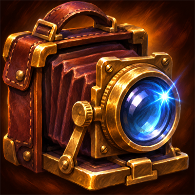
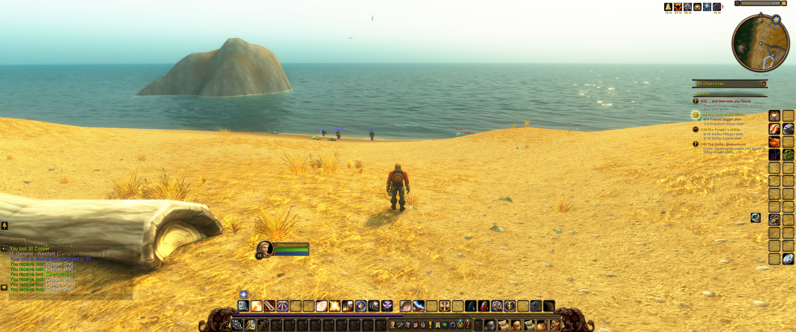
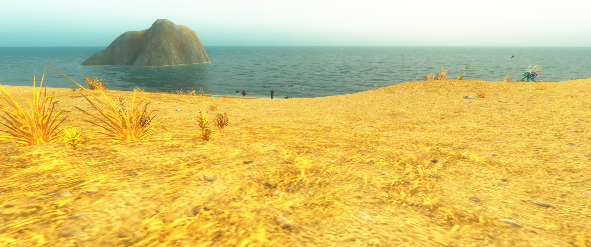

# PhotoMode Forever

**One click for a clean first-person screenshot in WoW: Forever.**

PhotoMode Forever is a small addon for **WoW: Forever** (Interface 16001). Press its button or type `/photo`. It hides every name, nameplate, chat bubble and the whole UI, switches to first person, takes a screenshot, and then puts your settings back the way they were.

| Before | After one click |
|---|---|
|  |  |

## Features

- **Clean shots.** Hides player, NPC, pet and guild names, titles, nameplates, chat bubbles and the UI. It also hides grey quest marks (low-level quests), marks for quests your warband has already completed, quest-target circles on the ground and the flight-master icon. The game has no setting for the normal yellow and blue `!` and `?` of quests at your level, so those stay in the picture.
- **No ghosting.** Waits until the camera has fully settled in first person, so your own head does not fade into the picture.
- **Everything comes back.** Every setting it changes is restored afterwards: CVars, the UI and your camera distance. This also works after an error, a `/reload` or a logout (not after a game crash mid-photo; see below).
- **Safe on any client.** It only touches settings that exist on your client.
- **Movable button.** Drag it anywhere. The position is saved per account.

## Install

### Players

1. On this page, click **Code → Download ZIP** (or download a release zip if one is listed under **Releases**).
2. Unzip it. Inside you will find a folder called `PhotoMode`, the one that holds `PhotoMode.toc`.
3. Copy that `PhotoMode` folder into your game's AddOns folder, for example:

   ```
   World of Warcraft\_forever_\Interface\AddOns\PhotoMode
   ```

   Copy only the `PhotoMode` folder, not the whole unzipped download. If the path ends in `AddOns\photomode-wow-forever-main\PhotoMode`, the game will not find it.
4. Start the game (or `/reload`). On the character screen, open **AddOns** and make sure **PhotoMode Forever** is enabled.

### Developers: link instead of copying

If you cloned the repo, link the addon folder into the game with a directory junction. Then a `git pull` updates the game copy too. Open **Command Prompt** and run this, replacing the two placeholder paths:

```bat
mklink /J "<WoW folder>\_forever_\Interface\AddOns\PhotoMode" "<repo folder>\PhotoMode"
```

Link to the `PhotoMode` folder inside the repo, not to the repo root. If `mklink` says access is denied, run Command Prompt as Administrator.

To remove the link later, run `rmdir "<WoW folder>\_forever_\Interface\AddOns\PhotoMode"`. This deletes only the junction. Your repo stays untouched.

## Usage

| Command | What it does |
|---|---|
| click the button / `/photo` | Take a clean screenshot. |
| drag the button | Move it. The position is saved per account. |
| `/photo debug` | Open a window with every setting the addon knows about: whether it exists on this client, its current value, and camera info. |
| `/photo restore` | Put back settings left over from an interrupted photo. |
| `/photo forget` | Give up on a restore that keeps failing. New photos are blocked until the restore succeeds or is forgotten. |
| `/photo reset` | Move the button back to its default spot. |
| `/photo help` | List the commands in chat. |

Screenshots are saved to the game's usual `Screenshots` folder.

## How it works

1. **Snapshot.** Records the current value of every setting it is about to change, plus your camera distance. The snapshot is also written to the addon's saved variables, so it survives a `/reload` or logout. (The game only writes saved variables on reload or logout, so a crash in the middle of a photo can lose it. If that happens, turn names and nameplates back on in the game's Interface options.)
2. **Hide.** Turns off every name, title, guild name, nameplate, chat bubble and quest marker setting that exists on your client. It also switches off the *Trivial Quests* and *Account Completed Quests* minimap tracking filters, then hides the UI.
3. **First person.** Zooms all the way in (briefly raising `cameraZoomSpeed` if your client has it). It waits until the camera has arrived and stopped moving, then waits a little longer so your character has fully faded out. If the camera has not settled after 3 seconds, it takes the shot anyway and tells you in chat.
4. **Screenshot.** Takes the picture.
5. **Restore.** Puts back every setting, the minimap tracking filters, the UI and your camera distance.

If anything goes wrong partway through, step 5 still runs. If a restore fails, the leftover parts are kept and tried again later. See [Troubleshooting](#troubleshooting).

## Limits

- **Out of combat only.** The game does not allow the UI to be hidden in combat. PhotoMode refuses to start in combat, and if combat starts partway through, it cancels the photo and restores everything.
- **Made for WoW: Forever (Interface 16001).** Other WoW versions have not been tested. They may have different setting names, or need a different `## Interface` number in `PhotoMode.toc`.
- Settings your client does not have are skipped. `/photo debug` shows which ones those are.

## Troubleshooting

**Names or the UI did not come back.** Type `/photo restore`. It reapplies any settings left over from an interrupted photo.

**PhotoMode keeps saying a restore is pending, and new photos will not start.** One setting keeps failing to restore. Type `/photo forget` to drop the pending restore. Your settings stay as they are now, so check your name, nameplate and chat bubble options in the game's Interface settings afterwards.

**Yellow or blue `!` and `?` quest marks still show over NPCs.** This is expected. The game draws the marks for quests at your level in the 3D world, not in the interface, and has no setting to hide them, fade them or make them smaller, so no addon can remove them. PhotoMode hides what the game does let it hide: grey marks for low-level quests, marks for quests your warband has already completed, and quest circles on the ground. For a clean shot of a particular NPC, accept or turn in their quest first, tilt the camera so the space above their head is out of frame, or remove the mark afterwards in an image editor.

**My head shows up in the picture, or something is not hidden.** Type `/photo debug`. The window opens with all its text already selected: press **Ctrl+C** to copy it (click inside and press **Ctrl+A** first if the selection is lost). Close it with the X button or **Esc**. Include this output when you report a problem.

The last debug report is also saved to disk, under the key `lastDebug`, in:

```
World of Warcraft\_forever_\WTF\Account\<ACCOUNT>\SavedVariables\PhotoMode.lua
```

The game writes that file when you `/reload` or log out.

## Configuration

All tunable values are in [`PhotoMode/Config.lua`](PhotoMode/Config.lua): the delays, the zoom wait (poll rate, settle frames, post-zoom delay, nudges, the 3-second cap), the zoom amount and speed, the alpha fallback mode, the debug window size, the button size and icon, and the full list of settings the addon may hide. Edit the file and `/reload` to apply your changes.

## Running the tests

`tests/run.lua` runs the core logic against a mocked WoW API, so it needs no game client. From the repo root, run it with any Lua 5.1 or newer:

```
lua tests/run.lua
```

The last line shows the number of tests and failures.

## License

PhotoMode Forever is released under the MIT License. See [LICENSE](LICENSE).
